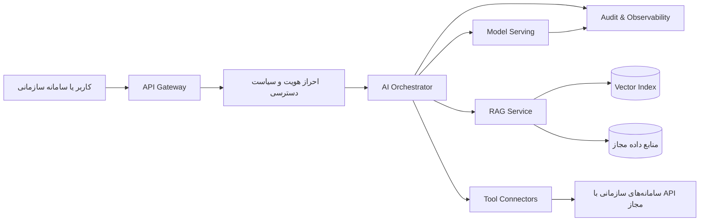

# معماری منطقی سامانه

## اجزا
- **API Gateway:** کنترل نرخ، احراز هویت اولیه و مسیریابی
- **Orchestrator:** اعمال سیاست‌ها، فراخوانی مدل و ابزارها
- **Model Serving:** اجرای مدل با کنترل منابع
- **RAG:** بازیابی اسناد مطابق مجوز هر درخواست
- **Tool Connectors:** اتصال محدود و قابل ممیزی به APIها
- **Observability:** متریک، تریس، رویداد امنیتی و مصرف منابع

دیاگرام نمای منطقی است و ادعای نصب یا راه‌اندازی اجزا ندارد.
